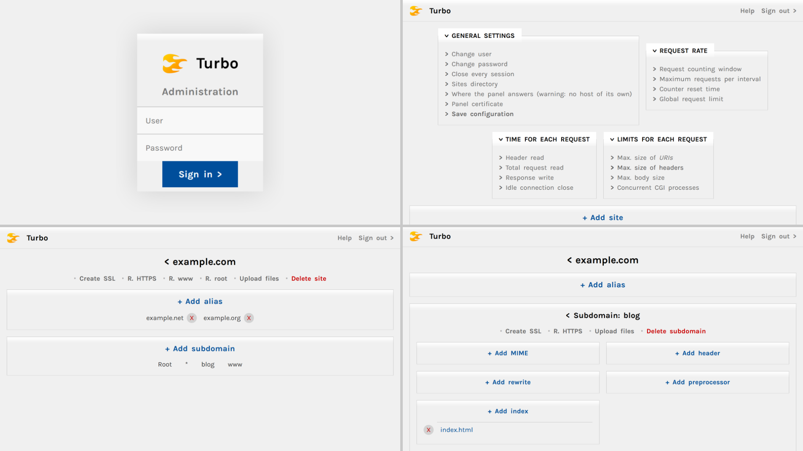

# Turbo


A cross-platform, high-performance HTTP web server with a real-time, visual management interface. Manage unlimited domains and multi-level wildcard subdomains, SSL certificates, URI rewrites, request preprocessing, fine-grained request rate and size limiting, as well as custom aliases, headers, MIMEs, and indexes.



---

## Key Features
- **High-Performance:** Built for speed and efficiency.
- **Visual Management:** Real-time, intuitive administrative interface.
- **Flexible Domain Handling:** Unlimited domains, multi-level wildcard subdomains, and aliases.
- **Security:** Integrated SSL certificate management and concurrency safety. See [Dependencies](#dependencies).
- **Traffic Control:** Fine-grained request rate and size limiting.
- **Deep Customization:** URI rewrites, request preprocessing, headers/MIMEs, and indexes.
- **HTTP/2 Rapid Reset Mitigation:** Go's protection against the [attack](https://blog.cloudflare.com/technical-breakdown-http2-rapid-reset-ddos-attack) (CVE-2023-44487) plus Turbo's own limit of `RST_STREAM` frames that cancel an open stream: 4 × the 50 concurrent streams, that is 200 per second and connection.

---

## Documentation

**Visual documentation (website aliases):** [turbo.okzgn.com](https://turbo.okzgn.com), [turbo-server.github.io](https://turbo-server.github.io)

**API documentation:** [API_SPECIFICATION.md](./API_SPECIFICATION.md) (in Spanish: [API_SPECIFICATION.es.md](./API_SPECIFICATION.es.md))

**Changes and upgrading:** [CHANGELOG.md](./CHANGELOG.md) ([español](./CHANGELOG.es.md)). Upgrading from v2.4 to v2.4.1 brings breaking changes: read "Upgrading from v2.4" first. Upgrading from v2.3.rc3 also changes the `turbo.config` format (the original is kept as `turbo.config.v1.bak`) and brings more: read "Upgrading from v2.3.rc3" first.

---

## Requirements

### Operating Systems
- **Windows:** Windows 10 or later.
- **Linux:** Ubuntu and other mainstream distributions. The release binaries are static (`CGO_ENABLED=0`) and need no system libraries; a binary built with cgo needs glibc 2.34 or later.
- **macOS:** Builds; not tested.

### System Architecture
- **x86-64** (Intel/AMD 64-bit processors).
- **ARM64** (ARMv8 and later, including AWS Graviton processors).

### Dependencies
- **Go 1.26+** (for building from source; releases use the latest Go 1.26 patch).
- No external runtime dependencies — Turbo is distributed as a single, self-contained static binary, except for **[Certbot](https://certbot.eff.org/)** for SSL certificate issuance. See [Commercial Version](#commercial-version).

### Minimum Recommended Requirements
- **CPU:** 1 vCPU (1.5 GHz clock speed or higher).
- **RAM:** ~128 MB for runtime or 1 GB+ to build from source.
- **Storage:** ~100 MB for binary + websites + configuration files.
- **Network:** Standard HTTP/HTTPS ports (80, 443), which need `CAP_NET_BIND_SERVICE` (or root) on Linux; other addresses can be set with `TURBO_HTTP_ADDR` and `TURBO_HTTPS_ADDR`.

---

## Installation

### From Source
```bash
git clone https://github.com/okzgn/turbo-go.git
cd turbo-go
CGO_ENABLED=0 go build -trimpath -ldflags "-s -w" -o turbo .

# Let a standard user open ports 80 and 443 (Linux), then run it without sudo
sudo setcap cap_net_bind_service=+ep ./turbo
./turbo
```

### As a systemd Service (Linux)
[`deploy/turbo.service`](./deploy/turbo.service) is a reference unit: Turbo runs as an unprivileged `turbo` user with `CAP_NET_BIND_SERVICE` (which the programs it runs, CGIs and Certbot, don't inherit), from `/usr/local/bin/turbo`, owned by root, so a CGI can't replace it; it has a private `/tmp`, is restarted if it fails, and its messages go to the journal (`journalctl -u turbo`). It also limits what a CGI that has been taken over can do on the rest of the host: it sees no other home folder and no devices, and can't create namespaces, change the kernel's settings or make system calls outside those of a service; and the files it creates aren't readable by other users (`UMask=0027`, with `/home/server` in `0750`). If a PHP extension needs more (a system call, an address family), give it that with a drop-in (`systemctl edit turbo`). CGIs and Certbot run as `turbo` too, so a CGI can change the sites, `turbo.config` and the certificates, and read Turbo's environment, `TURBO_USER` and `TURBO_PASSWORD` included: give a site you don't trust another server. With `NoNewPrivileges`, install Certbot with apt or pip, not snap. The comments in the file explain how to install it, and PHP sessions. Its steps create `turbo.dev` owned by root, which the service needs (a CGI can't create it to change the panel's pages), and `/etc/turbo/credentials` (`0600`, root) with `TURBO_USER` and `TURBO_PASSWORD`, so the panel never answers with the default credentials. `systemctl stop` lets the requests in progress end, CGIs included, for up to 10 s. If you move the sites directory out of `/home/server`, change the paths of the unit too, and create the new folder's `turbo.dev` owned by root, or the service won't start.

### Supported Platforms
```bash
# Linux x86-64
CGO_ENABLED=0 GOOS=linux GOARCH=amd64 go build -trimpath -o turbo-linux-amd64 .

# Linux ARM64 (AWS Graviton, Raspberry Pi, etc.)
CGO_ENABLED=0 GOOS=linux GOARCH=arm64 go build -trimpath -o turbo-linux-arm64 .

# Windows
CGO_ENABLED=0 GOOS=windows GOARCH=amd64 go build -trimpath -o turbo.exe .

# macOS x86-64
CGO_ENABLED=0 GOOS=darwin GOARCH=amd64 go build -trimpath -o turbo-darwin-amd64 .

# macOS ARM64 (Apple Silicon)
CGO_ENABLED=0 GOOS=darwin GOARCH=arm64 go build -trimpath -o turbo-darwin-arm64 .
```

Releases are built with [`release.sh`](./release.sh) once `HEAD` is tagged with the version (`git tag v2.4.1 && bash release.sh v2.4.1`); it also checks that the tree is clean, that `customNetHttp` matches the Go version in use (see [customNetHttp/PATCHES.md](./customNetHttp/PATCHES.md)) and that each binary was built from the tagged commit, without changes and without cgo, and runs `govulncheck` on the binaries before writing `SHA256SUMS`: without `govulncheck` it stops (`TURBO_RELEASE_WITHOUT_GOVULNCHECK=1` skips it on purpose), and if anything fails it removes `dist/<version>`.

Before a release, [`deploy/real-ports-test.sh`](./deploy/real-ports-test.sh) checks a build on Linux with the real ports 80 and 443: HTTP, HTTPS redirection, HTTP/1.1 and HTTP/2, TLS versions, SNI, size limits, log messages and the exit when port 80 is taken. It needs `sudo -n setcap` and free ports; with `TURBO_BIN=<binary>` it tests that binary, for example one from `release.sh`, instead of building one. On a Linux with systemd and no Turbo installed, [`deploy/systemd-test.sh`](./deploy/systemd-test.sh), run as root with a binary, installs the reference unit as its comments say, checks it (the user and capabilities of Turbo and of its CGIs, what a CGI can write, the private `/tmp`, the restart after a failure, the stop, the journal and, with a test CA, Certbot under `NoNewPrivileges`) and removes it all. [`deploy/upgrade-test.sh`](./deploy/upgrade-test.sh) configures an earlier version from the panel (with the real ports, which v2.3.rc3 needs), replaces it with the new one on the same sites folder, checks that it serves the same, checks the credentials (the saved ones, or `Admin` from v2.3.rc3, which didn't save the password) and that `turbo.config` is migrated as the CHANGELOG says, and goes back.

### Checks Before Publishing
[`.github/workflows/ci.yml`](./.github/workflows/ci.yml) runs these checks on GitHub Actions on every push and pull request: on Linux, all of them, with the tests also under `-race`, the real-ports test and 15 s of fuzzing per target in three parallel shards; on Windows, the tests. Before merging a change or publishing a release, run them by hand too, from the repository root, with the latest patch of the Go version in `go.mod`:

```bash
gofmt -l .                                   # no output (on Windows, check the files without CR)
go vet ./...
staticcheck ./...                            # no warnings outside customNetHttp
govulncheck ./...
gosec .                                      # the main package: customNetHttp is Go's code, internal/ the test tools
go run ./customNetHttp/regenerate -check     # customNetHttp == Go of UPSTREAM + the patches
go test -count=1 ./...                       # on Windows and on Linux
go test -race -count=1 -timeout 30m ./...    # on Linux or WSL (see below); about 10 min, over go test's default timeout
bash deploy/real-ports-test.sh               # on Linux, with ports 80/443 free and sudo -n setcap
for f in $(grep -ho '^func Fuzz[A-Za-z0-9_]*' *_test.go | cut -c6-); do go test -run '^$' -fuzz "^$f\$" -fuzztime 1m .; done
CGO_ENABLED=0 GOOS=linux GOARCH=arm64 go build -o /dev/null .
CGO_ENABLED=0 GOOS=darwin GOARCH=arm64 go build -o /dev/null .
CGO_ENABLED=0 GOOS=windows GOARCH=amd64 go build -o /dev/null .
```

`-race` needs cgo and a C compiler. Run it on Linux or in WSL: on Windows it needs gcc (MinGW), whose linker fails when the path of the Go installation or of the user folder has spaces. The tests compile two helper tools (a CGI and a simulated Certbot) in `TOOLS_BIN`, or in a temporary folder; on Windows `TOOLS_BIN` should be a short path, as Turbo rejects preprocessor paths longer than 128 characters.

### Execution
- **Windows:** `turbo.exe` opens ports 80 and 443 without Administrator rights (Windows has no privileged ports), as long as no other program, such as IIS, uses them. To be reached from other machines, the Windows Firewall needs an inbound rule for those ports, and creating it does take an administrator (the dialog shown at the first start, or `netsh advfirewall firewall add rule`).
- **Linux:** Grant execution permissions with `chmod +x` and run it: `./turbo` (requires free ports 80 and 443, or the addresses in `TURBO_HTTP_ADDR` and `TURBO_HTTPS_ADDR`). If it cannot open the HTTP address, Turbo exits with an error.
- **Which version is running:** the first line Turbo writes says it, with the commit it was built from and the Go it was built with, for example `level=INFO msg=Starting server="OKZGN Turbo" version=v2.4.1 commit=<hash> go=go1.26.10` (under systemd, `journalctl -u turbo | grep msg=Starting`). Compare it with the affected versions of a security advisory. A binary built from the source says `version=development`, and its commit ends in `+modified` if the tree had changes (`commit=unknown` if it was built without version-control information, as from a source archive).
- **A site whose folder disappears** (a deploy that deletes and recreates `@`, an upload by FTP, a network disk that is gone for a moment) is deactivated while its folder or its `@` isn't there, and comes back with its settings, also after a restart: they stay in `turbo.config` until the site is deleted from the panel (also without its folder) or from the file. Only a folder that doesn't exist counts: when the disk doesn't answer (permissions, I/O), the site stays as it is, and when the sites directory can't be read, no site is deactivated. A site of `turbo.config` whose folder doesn't exist yet, or can't be read when the file is read (permissions, I/O), gets its settings when the folder can be used. The panel lists the sites kept without their folder in **Sites without their folder**, where they can be deleted: deleting the folder of a site doesn't delete the site. A site created from the panel starts with the defaults.
- **PHP:** add a preprocessor for the `php` extension with the path of `php-cgi` (for example `/usr/bin/php-cgi`, from the `php-cgi` package). Turbo sets `REDIRECT_STATUS`, so `cgi.force_redirect` can stay on; PHP gets the URL path of the script in `PHP_SELF` and `SCRIPT_NAME`, the original `REQUEST_URI`, `CONTENT_LENGTH` also for chunked bodies (Turbo reads the whole body before the script starts), and the temporary folder of Turbo (`TMPDIR`, or `TEMP` and `TMP` on Windows), where it keeps uploads (and sessions when `session.save_path` is empty, as on Windows). Checked with PHP 8.5 on Ubuntu 26.04: forms, uploads with `move_uploaded_file`, `php://input`, `header()` and `http_response_code()`, sessions, scripts that pass `WT` (504, their processes killed) and fatal errors (500, with no details while `display_errors` is off, the default). Under the reference systemd unit, `/var/lib/php/sessions` (the default `session.save_path`) is read-only: point it to a folder inside `/home/server`.
- **What a CGI gets of the request:** the headers with `_` in their name don't reach it, as in Apache (`X_Forwarded_For` would become the same `HTTP_X_FORWARDED_FOR` as the `X-Forwarded-For` of a proxy in front), and `HTTP_HOST` and `SERVER_NAME` carry the host as it chose the site: in lower case, without a final dot, and with its port only if it is a number.
- **Editing `turbo.config` by hand:** Turbo checks it every 30 s and, when it changes, applies it as it is: what isn't in the file any more (a header, an alias, a preprocessor, a denied IP…) stops applying, and changes made from the panel and not saved are lost. Sites, entries and settings are applied in a fixed order, and when two clash (`R` and `W` both on, `PHP` and `php`, an alias in two sites) the first wins and the log says so.
- **Invalid `turbo.config`:** if `turbo.config` is there but cannot be read (permissions, a broken symbolic link, a folder with that name) or is not valid JSON (for example after a manual edit), Turbo does not start: it exits with code 1 and writes to `stderr` the file, the line and column of the error and the backups (`.bak`) next to it (never the password hash). The same happens if the sites folder cannot be read. Only a missing `turbo.config` means a new installation, with the defaults. If the file breaks or disappears while Turbo is running, the configuration in use is kept and the log says so. Under systemd (`deploy/turbo.service` restarts it on failure) the service keeps restarting until the file is fixed; `journalctl -u turbo` shows the message. The same happens if `turbo.config` is not a JSON object (`null`, an array…). A single setting that can't be applied (out of range, or of another type) does not stop Turbo: its default is used and the log says which key and why (the password hash is never shown). The exception are the settings that guard the panel, `PA`, `U` and `PH` (or `P` without `PH`): if one can't be used (also with a control character, such as an escaped `\n`), the file counts as invalid, because its default would open the panel to every host or bring back `Turbo`/`Admin`. So does a site, or a list of a site, that isn't a JSON object (skipped, the site would be served without its preprocessors, its scripts as text), and a whole `turbo.config` whose `M` names a directory that doesn't exist or can't be listed. A preprocessor of `turbo.config` that can't be used (a program that isn't there, a control character) makes its extension answer 500. Numbers may be written as JSON integers (`"MBB": 5242880`) or as strings.

---

## Getting Started

Once Turbo is running, access the admin interface (GUI) at:

- `http://localhost/admin:`
- `http://<your-server-ip>/admin:`
- `http://<your-domain>/admin:`

**Default credentials:**
- **Username:** `Turbo`
- **Password:** `Admin`

> Change the default credentials immediately after your first login, **or compile from source**. See [GUI section](https://turbo-server.github.io/#Get-started-on-interface). While they are in use, Turbo warns about it at startup. After 5 failed logins from the same IP within 10 minutes, that IP must wait before trying again (1 minute, then longer, up to 15); the IPv6 /64s of a /48 share a limit of 20. A new password needs 12 to 64 bytes. A session ends after 10 minutes without requests, and 12 hours after the login at most; changing the user or the password, or **Close every session** (in **General settings**), ends every session, and the browser that did it goes on with a new one.

**Give the panel a host of its own.** Without any entry in `PA` (by default `PA` is empty) the panel answers on every host, the sites' included, so a page served by Turbo on a site's host (uploaded by a customer, or compromised) shares the panel's origin and could use the administrator's session. With networks and no host, the panel answers only on an IP address or `localhost`, never on a name: a page whose name resolves to Turbo (DNS rebinding) would otherwise reach it from the browser of someone in those networks. Turbo warns about both at startup. The recommended setup is a host name that serves no site, only for the panel, for example `admin.example.com` with its own certificate: set it in **Where the panel answers** (`PA`), optionally together with the networks allowed to reach the panel (with both, a request needs both). Turbo refuses a `PA` host that serves a site, and a new site, subdomain or alias that would serve the `PA` host. A site folder created on disk for the `PA` host is still activated (the disk is where sites come from), and the log warns that the panel shares its origin with it: remove or rename that folder. Every error page is sent with a `Content-Security-Policy` that allows no scripts, on every host, so an error template can't run code on the panel's origin; on a `PA` host, so is everything other than the panel's own pages. Changing an error template or a character replacement needs the current password, as the settings do.

**HTTPS for the panel's host:** in the panel, **Panel certificate** has Certbot issue a certificate for the hosts in `PA` (by HTTP on those hosts, or with a DNS adapter), and Turbo renews it like the sites' ones. You can also put one by hand in the `turbo.panel` folder of the sites directory (`fullchain.pem` and `privkey.pem`; Turbo reads them again when they change, but doesn't renew them), or put a TLS proxy in front of Turbo for that host. With a certificate and HTTPS open, the panel redirects HTTP to HTTPS and, on its own host, sends `Strict-Transport-Security` (one year). Over plain HTTP, the credentials and the session travel in clear text.

**Notes:**

- An example `turbo.config` is in [`testdata/config/v2-example.json`](./testdata/config/v2-example.json). Running Turbo in the root of the repository leaves nothing for git: `turbo.config`, its copies, the certificates, `turbo.certificates/`, `turbo.panel/` and the logs are in `.gitignore`.
- The repository has one sample site, [`localhost/@/index.html`](./localhost/@/index.html): run from the repository root, Turbo serves it at `http://localhost/` (by default, the sites directory is the working directory).
- If you run `./turbo` directly or without a `turbo.config` file, the folder to be served must be registered through the GUI using the exact site name routed to your server, the exact IP address, or `localhost` if running locally.
- The **GUI can be customized or fully replaced**: copy the `turbo.dev` folder to the sites directory and modify its files. Each file there replaces the embedded one; files that are missing are served from the binary.
- On Windows, use [`rsrc`](https://github.com/akavel/rsrc) (installed beforehand) to generate a `.syso` file from `turbo.windows.manifest` and `turbo.icon.png`, then link it with the executable to produce an `.exe` with a custom icon. The published `turbo-windows-x64.exe` is built by `release.sh` without them.
- **Sites directory:** by default, the working directory; `TURBO_DIR` sets another one. `M` (and `TURBO_DIR`) may be relative to the working directory or use `{TURBO_CURRENT_DIR}`, and `M` is saved as written, so the configuration can be moved to another machine. If the directory is changed from the GUI and the configuration is saved, the `turbo.config` of the starting directory keeps a pointer to the new one; if that file had a whole configuration, it is first copied next to it (`turbo.config.<date>.bak`). A `turbo.config` that only points to its own directory (what saving could leave before v2.4), or to one that doesn't exist, has no `turbo.config` or an unusable one, or points back to it, stops Turbo from starting: restore one of its `.bak` copies, or make that directory available again. A whole `turbo.config` whose `M` names a directory without `turbo.config` applies there, with its sites, which are those of that directory: the next save writes it there and leaves a pointer here (after copying the whole one), so edit the one there afterwards; until that save, a change to this one is read at the next start. A whole `turbo.config` whose `M` names a directory that doesn't exist (a disk not mounted yet) or can't be listed, or one with a `turbo.config` that can't be used (invalid, or with pointers that lead back), stops Turbo from starting too, and a reload keeps the configuration in use; changing the directory from the GUI checks the same before changing anything. If the `turbo.config` of the starting directory is a symbolic link to that of the new one, saving leaves it whole. Changing to a directory without `turbo.config` from the GUI keeps the settings in use (global settings, credentials, denied IPs, replacements and responses), which are written there with the next save; one with `turbo.config` applies it whole, and the panel says what changes of `PA` and of the credentials.
- **Environment Variables:**
  - `TURBO_USER`, `TURBO_PASSWORD`: panel credentials. They take priority over the configuration. Set but empty, Turbo does not start, nor with a `TURBO_USER` of more than 24 characters or with control characters (it is saved as `U`, which can't be one), nor with a `TURBO_PASSWORD` of more than 64 bytes or with control characters. With the password still `Admin`, whatever the user, or with fewer than 12 bytes, Turbo warns at startup.
  - `TURBO_DIR`: sites directory.
  - `TURBO_HTTP_ADDR`, `TURBO_HTTPS_ADDR`: listening addresses (`host:port`, `:port` or just the port; by default `:80` and `:443`), for example to run Turbo behind a proxy. Redirections to HTTPS go to the port of `TURBO_HTTPS_ADDR` when it is not 443.

  Credentials can also be changed via the GUI: saving the configuration stores the username and a PBKDF2 hash of the password in `turbo.config`.
- A request for a path ending in `/index.html` is redirected (301) to its folder (`./`), as Go's file server does.

**Logs:**
- To log the IPs blocked by the rate limiter and the failed-login lockouts (one line per block, not one per rejected request; requests rejected by `CGL` are not logged), create an accessible file named `turbo.denials` in the sites directory; to log every access to every file or route on the server, create one named `turbo.visits`. Turbo checks for these files every 30 seconds, so logging starts (or stops, after deleting the file) within that time; a file rotated by renaming it (logrotate's `create`) is noticed then too, and the new one is used. Fields with spaces or control characters (an HTTP/2 path may have them) are written quoted and escaped. Do not create these files if logging is not needed, as they can grow very large.
- **Privacy:** for every request that reaches Turbo's handler, `turbo.visits` records the client IP, the time, the method, the host and the full URL with its query string, including the requests to the GUI. It never records request bodies. It does not record everything: requests answered by the rate limiters (429, 503), connections closed on arrival from a blocked IP, and requests rejected before the handler because they are malformed or too large (400, 414, 431) are not in it; the blocks and the failed-login lockouts are in `turbo.denials`.
  - The GUI sends its parameters, including the current password (`b`) of the general settings, in the request body, so they do not appear in the URL or in `turbo.visits`. The exception is `hardUpload`, which sends the site and subdomain (`s`, `d`) in the URL, as they aren't sensitive; its password goes in the body with the files.
  - An API client that put the password (or any other sensitive value) in the URL would leave it in `turbo.visits`: send the parameters in the body (`application/x-www-form-urlencoded`), as the GUI does.
  - Treat `turbo.visits` as sensitive: restrict its permissions, do not share it, rotate or delete it, and do not commit it to version control (both log files are in `.gitignore`). Nothing is logged if the file does not exist.
- Any other message (startup, configuration, sites, certificates, errors) goes to `stdout` with a level and a timestamp (`time=… level=INFO msg=…`); under systemd, to the journal. The exception is the message of an invalid `turbo.config` at startup, which goes to `stderr`. The errors of the connections (failed TLS handshakes from scanners, clients without SNI or with a host without certificate, connections closed because their IP is blocked, malformed HTTP/2 frames…) and those of the CGIs (a client that went away) are grouped by kind: the first of each kind is logged at once, and then at most one line a minute with the count and the last one, so that they can't fill the log.

---

## Known Limitations
- This version was tested on Ubuntu 26.04 LTS (in WSL 2, with systemd: the reference unit installed, PHP 8.5 and Certbot against a test CA) and on Windows 11, x86-64. The ARM64 Linux binary was run under QEMU user emulation, not on ARM hardware. macOS builds but has not been tested. Alpine and Amazon Linux have not been tested with this version (earlier versions were, extensively); `deploy/real-ports-test.sh` checks a build on any Linux.
- Admin interface (GUI) not extensively tested on older OS versions or old browsers.
- Behind a proxy, Turbo sees the proxy's address as the client IP: the rate limits, denied IPs, logs, `PA` networks and the binding of panel sessions to an IP all see only the proxy, and 5 failed logins through it lock every client out of the panel, the administrator included, for up to 15 minutes.
- The checks for the file names Windows treats specially (a final `.` or space, `:`, device names such as `CON` or `COM1`, 8.3 short names, and the characters `<>"|?*` and control characters) depend on the system Turbo runs on, not on the file system: on Linux or macOS, a sites folder on an SMB share or a FAT (vfat) volume does not have them for requests. File upload and index names apply them on every system.
- When Turbo stops, it gives the requests in progress up to 10 s; then it closes their connections, which ends their CGIs with whatever they started, and waits up to 3 s for them to be gone. A CGI that starts a process in a session of its own (`setsid`, a daemon) escapes its process group: under the reference unit, systemd kills it (`KillMode=mixed`), and on Windows its Job Object does.
- A CGI ends when its client goes away, also when an HTTP/1 client only closes its sending side after the request, as some command-line tools do (`nc -N`): the CGI is killed and the response is a 500.
- The output of a CGI waits for a slow client in memory (up to 1 MiB per response and 64 MiB in all) and then in a temporary file in Turbo's temporary folder (up to 256 MiB per response and 1 GiB in all), so the CGI frees its slot (`CGP`) when it ends; beyond those limits, it waits for its client. An HTTP/2 connection where nothing can be written for 30 s is closed, with every request on it.

---

## Commercial Version

The commercial license includes the following features:

- **Rust Plugins:** Extend and customize Turbo's behavior with high-performance native plugins written in Rust (e.g., dynamic content serving as a [CGI alternative](https://turbo-server.github.io/#so-3), and more).
- **More powerful features:** Integrated SSL certificate issuance, smarter rate-limiting and routing engine, and **updated `customNetHttp`**.

Interested in the commercial version? Contact:
- https://okzgn.com/#contact
- https://okzgn.github.io/#contact

---

## Architecture & Design Philosophy

Turbo is engineered as a high-performance, single-binary solution with a focus on efficiency, developer experience, and architectural integrity.

*   **Real-Time Admin Interface:** Turbo provides a fully embedded, zero-dependency Web GUI, enabling real-time management of domains, SSL certificates, and traffic policies without requiring external tooling or complex deployments. See [Dependencies](#dependencies). It is not intended to be used through API.

---

## Contributing

1. **Report Issues:** Found a bug? Open an issue and include:
   - **Steps to reproduce:** A clear, step-by-step description of how to trigger the issue.
   - **Expected behavior:** What you expected to happen.
   - **Actual behavior:** What actually happened, including any error messages or logs.
   - **Environment:**
     - OS and version (e.g., Ubuntu 22.04, Windows 11)
     - Architecture (e.g., x86-64, ARM64)
     - Environment/Image/VM description (e.g., RAM, disk space, running processes, capabilities, limitations...)
     - Go version (if building from source)
     - Relevant Turbo configuration files, denial logs, visit logs (redact sensitive data before sharing)
     - Turbo version and commit (the first line Turbo writes: `version=` and `commit=`)

2. **Suggest Features:** Describe your use case and expected behavior in a GitHub issue.

3. **Security Concerns:** See [SECURITY.md](SECURITY.md). For non-critical vulnerabilities, open a GitHub issue. For critical vulnerabilities, please contact us privately and await our response and decision before disclosing publicly at:
   - https://okzgn.com/#contact
   - https://okzgn.github.io/#contact

---

## License

Turbo uses a dual licensing model.

* **Open Source (AGPL v3):**

    This program is free software: you can redistribute it and/or modify it under the terms of the GNU Affero General Public License (AGPL v3) as published by the Free Software Foundation. If you modify this software and offer it as a service over a network, you must release your modifications under the same license. See: https://www.gnu.org/licenses/agpl-3.0.html

* **Commercial License:**

    For those who intend to use Turbo in a proprietary project, integrate it into a closed-source product, or opt out of the AGPL v3 requirements, a commercial license is available for purchase.

    For commercial licensing inquiries, please visit one of the following:
    - https://okzgn.com/#contact
    - https://okzgn.github.io/#contact

* **Third-Party Components:**

    The `customNetHttp` package contains the Go standard library `net/http` of Go 1.26.x (the exact version is in `customNetHttp/UPSTREAM`) with Turbo's patches, described in [`customNetHttp/PATCHES.md`](./customNetHttp/PATCHES.md). It is distributed under the **BSD 3-Clause License**. Please refer to the `customNetHttp/LICENCE`, `customNetHttp/PATENTS` and `customNetHttp/NOTICE` files within that directory for full details and attribution.

---

Copyright (C) 2026 [OKZGN](https://okzgn.com)
